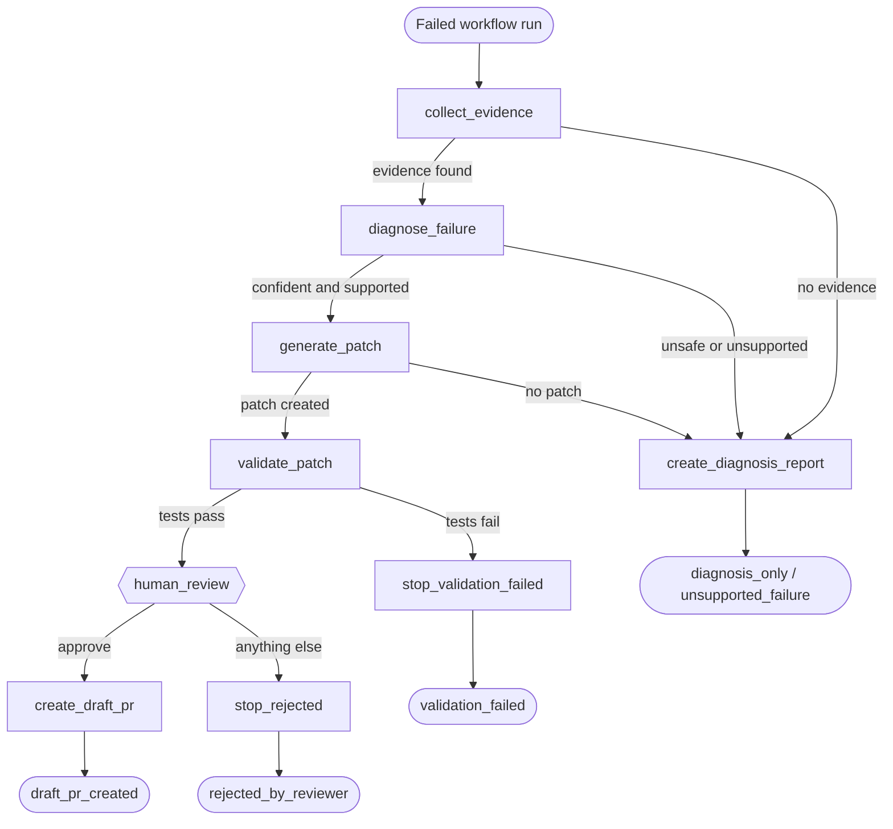

# GitHub Pipeline Recovery Agent

[](https://github.com/mee-tan/github-pipeline-recovery-agent-/actions/workflows/ci.yml)

The GitHub Pipeline Recovery Agent is an agentic AI system that responds to failed GitHub Actions workflows. When a pipeline fails, the agent collects the relevant logs and code changes, works out the likely cause, and (where it is safe to do so) prepares a fix, validates it by running the tests, and opens a **draft** pull request for a developer to review. When it isn't safe or confident enough to change code, it stops and writes a diagnosis report instead.

The project demonstrates event-driven architecture, CI/CD integration, autonomous tool selection, software testing, AI evaluation, and human-in-the-loop control.

**Author:** Misha Mansoor, AI Capstone Project (Group 1), Centennial College, Semester 6

---

## Contents

1. [Safety principles](#1-safety-principles)
2. [How a recovery works](#2-how-a-recovery-works)
3. [Repositories and folder layout](#3-repositories-and-folder-layout)
4. [Getting started](#4-getting-started)
5. [Project status](#5-project-status)
6. [Development log](#6-development-log)
7. [Tests](#7-tests)
8. [Problems found and how they were fixed](#8-problems-found-and-how-they-were-fixed)
9. [Roadmap and known limitations](#9-roadmap-and-known-limitations)
10. [Further documentation](#10-further-documentation)

---

## 1. Safety principles

These rules shape every design decision in the project:

- **Evidence first.** Every diagnosis must cite the evidence it is based on (`E1`, `E2`, …). An unsupported claim is not allowed.
- **Secrets never reach the model.** All text is redacted before it is stored or sent anywhere.
- **Small, bounded evidence.** Only the few lines that explain a failure are kept, never a whole log.
- **Stop rather than guess.** Low confidence, unsupported failures, missing evidence, failed validation: each one ends in a safe, named state with a report.
- **Fail closed.** Anything not yet built, and any answer other than an explicit "approve", is treated as "no".
- **A human decides.** The agent can only open a draft pull request after a person approves it. It can never merge.
- **Everything is auditable.** Every step of every recovery is recorded.

---

## 2. How a recovery works

Each recovery is a [LangGraph](https://langchain-ai.github.io/langgraph/) state machine. A recovery always finishes in one of the named terminal states.



| Terminal state | When it happens |
|---|---|
| `draft_pr_created` | Evidence, a confident diagnosis, a patch, passing tests **and** human approval |
| `diagnosis_only` | No evidence, low confidence, or no patch possible: a report is written |
| `unsupported_failure` | The failure is not a kind the agent is allowed to fix |
| `validation_failed` | The patch did not pass the tests, so a human is never asked |
| `rejected_by_reviewer` | The reviewer answered anything other than "approve" |
| `internal_error` | A stage crashed; the error is caught, recorded and the recovery stops |
| `duplicate_ignored` | The same failure was delivered twice (used by the webhook, Stage J) |

---

## 3. Repositories and folder layout

The project uses **two separate repositories**, so the agent can never accidentally change its own code instead of the project it is fixing:

| Repository | Purpose |
|---|---|
| [`github-pipeline-recovery-agent-`](https://github.com/mee-tan/github-pipeline-recovery-agent-) (this one) | The agent |
| [`demo-repo-recovery-agent-target`](https://github.com/mee-tan/demo-repo-recovery-agent-target) | A small calculator project with deliberately broken branches for the agent to diagnose |

```
github-pipeline-recovery-agent-/
├── app/
│   ├── api/            FastAPI app (health endpoint; webhook in Stage J)
│   ├── agents/         Diagnosis logic (rule-based now; LLM in Stage E)
│   ├── github/         GitHub REST client (Stage D)
│   ├── models/         Data models: evidence, recovery state
│   ├── orchestration/  The LangGraph recovery graph and runner
│   ├── policy/         Limits and safety rules: config, secret redaction
│   ├── prompts/        Versioned prompt templates (Stage E)
│   ├── sandbox/        Isolated patch validation (Stage H)
│   ├── storage/        Audit log (SQLite)
│   ├── tools/          Log extraction and other approved tools
│   └── cli.py          Run a recovery by hand
├── benchmark/
│   ├── cases/          Ground truth for each seeded failure
│   └── scoring/        Scoring scripts (Stage K)
├── docs/               One walkthrough per development step
├── tests/
│   ├── fixtures/logs/  Real failed CI logs from the demo repository
│   └── unit/           Unit tests
└── pyproject.toml      Dependencies and tool settings
```

---

## 4. Getting started

**Requirements:** Python 3.12 or newer, git, and optionally the [GitHub CLI](https://cli.github.com/) (`gh`).

```bash
git clone https://github.com/mee-tan/github-pipeline-recovery-agent-.git
cd github-pipeline-recovery-agent-
python3 -m venv .venv
source .venv/bin/activate        # Windows: .venv\Scripts\activate
pip install --upgrade pip
pip install -e ".[dev]"
```

**Run the tests and the linter:**

```bash
pytest
ruff check .
```

**Run a recovery on a saved failed log:**

```bash
python -m app.cli --log tests/fixtures/logs/logic_bug.log
```

The agent reads the log, finds the failing step, diagnoses the failure, and, because patch generation is not built yet, stops honestly with a `diagnosis_only` report and its audit log.

**Run a recovery on a real failed run on GitHub** (read-only; uses the token from the GitHub CLI):

```bash
export GITHUB_TOKEN=$(gh auth token)
gh run list --repo mee-tan/demo-repo-recovery-agent-target --branch seed/logic-bug --limit 1
python -m app.cli --run-id <RUN_ID>
```

The agent downloads the failed job's log and the branch's changes, and cites both as evidence. Never commit or print the token.

**Watch the full path, including the pause for human approval**, using clearly labelled fakes for the stages not built yet:

```bash
python -m app.cli --log tests/fixtures/logs/lint_unused_import.log --demo-fake-fix
```

It pauses and asks you to type `approve` or `reject`. Nothing is changed on GitHub.

**Start the API** (health check only for now):

```bash
uvicorn app.api.main:app --reload
curl http://localhost:8000/healthz      # {"status":"ok"}
```

---

## 5. Project status

| Stage | Description | Status |
|---|---|---|
| Phase 1 | Repositories, folder structure, FastAPI health check, CI | Done (Oct 20) |
| Phase 1b | Three seeded failures, real failed logs, ground truth | Done (Nov 12) |
| Stage B (5.1) | Evidence models with hashing and a size budget | Done (Nov 12) |
| Stage B (5.2) | Secret redaction | Done (Nov 12) |
| Stage B (5.3) | Log extraction | Done (Nov 14) |
| Stage C | LangGraph recovery graph, audit log, policy config, CLI | Done (Nov 16) |
| Stage D | GitHub client: fetch a run's log and changes by run ID | Done (Nov 20) |
| Stage E | LLM diagnosis with evidence citations | In progress |
| Stage G | Patch generation and patch policy | Planned |
| Stage H | Sandboxed validation | Planned |
| Stage I | Draft pull request and human approval | Planned |
| Stage J | Webhook with signature verification | Planned |
| Stage K | Benchmark and evaluation | Planned |

---

## 6. Development log

A record of each step, in order: what was built, why, and what was learned. Each step has a detailed walkthrough in [`docs/`](docs/).

### Phase 1: Repositories, demo project and CI scaffolding

**Goal:** a clean, tested starting point that every later stage can build on.

1. **Checked prerequisites:** Python 3.12+ and git.
2. **Created two repositories:** the agent and the demo target. Keeping them separate is a safety decision: the agent must never be able to modify itself by mistake.
3. **Built the folder skeleton:** one `app/` folder per component (`api`, `github`, `orchestration`, `agents`, `tools`, `sandbox`, `policy`, `models`, `storage`, `prompts`), plus `tests/` (`unit`, `integration`, `security`, `end_to_end`) and `benchmark/` (`cases`, `scoring`). Everyone knows where new code belongs before any code exists.
4. **Made each folder a Python package** with an empty `__init__.py`, and kept empty folders in git with `.gitkeep`.
5. **Wrote `pyproject.toml`:** runtime dependencies (FastAPI, LangGraph, httpx, Pydantic, PyJWT, SQLAlchemy), development tools (pytest, ruff, respx), and ruff settings.
6. **Created a virtual environment** at the repository root and installed the project in editable mode (`pip install -e ".[dev]"`), so code changes take effect without reinstalling.
7. **Wrote a FastAPI app** with a `/healthz` endpoint: the smallest slice that proves the whole chain works.
8. **Wrote the first automated test** with FastAPI's `TestClient`, which runs the app in-process with no real server.
9. **Added CI** (`.github/workflows/ci.yml`): on every push and pull request, GitHub Actions installs the project, runs `ruff check .` and runs `pytest` with coverage.
10. **Set up the demo repository** the same way: a small calculator (`add`, `subtract`, `multiply`, `divide`) with five pytest tests, ruff and CI.


### Phase 1b: Seeding real failures

**Goal:** real failed pipeline runs to build and test against. The proposal's Week 1 exit evidence asks for "three seeded failing workflows".

1. **Kept `main` green** and put each deliberate bug on its own branch, so every failure is reproducible and isolated.
2. **Changed the demo CI trigger** to also run on `seed/**` branches and to allow manual runs (`workflow_dispatch`). Without this, pushes to the seed branches would never have run CI.
3. **Created three seed branches**, each failing at a different point in the pipeline:

   | Branch | Bug | Where CI fails |
   |---|---|---|
   | `seed/lint-unused-import` | `import os` added but never used | **Lint** step (ruff F401 and I001); Test is skipped |
   | `seed/import-error` | `subtract` renamed to `subtact` | **Test** step, while pytest collects tests (`ImportError`) |
   | `seed/logic-bug` | `subtract` returns `b - a` | **Test** step: 1 failed, 4 passed (`assert -2 == 2`) |

4. **Downloaded each failed log** with the GitHub CLI (`gh run view <id> --log`) and saved them as test fixtures in `tests/fixtures/logs/`. Each log is about 24,000 characters; the actual error is around line 200.
5. **Wrote the ground truth** in [`benchmark/cases/README.md`](benchmark/cases/README.md): for each case, the category, failed step, root cause, correct fix, and **forbidden changes** (for example, editing the test's expected value is cheating, not fixing).

### Stage B, step 5.1: Evidence models

**Goal:** define what a piece of evidence is, so every diagnosis can cite it ([walkthrough](docs/phase5_1_evidence_models.md)).

- `EvidenceItem` (in `app/models/evidence.py`): an ID (`E1`, `E2`, …), its source (`log`, `diff` or `file`), its location, a line range, the text, a `redacted` flag, and a **SHA-256 hash** of the text. Items are **frozen** (they cannot be changed after creation), and the hash proves the evidence wasn't altered.
- `EvidenceBundle`: all evidence for one run, with a **size budget** (20,000 characters by default). Adding an item that would exceed the budget, or that reuses an ID, is refused.
- Built with Pydantic, so invalid data is rejected the moment it is created.
- 19 tests, including boundary tests (exactly at the budget is allowed; one character over is refused).

### Stage B, step 5.2: Secret redaction

**Goal:** make sure no credential ever reaches the model, the audit log or a pull request ([walkthrough](docs/phase5_2_redaction.md)).

- `redact()` (in `app/policy/redaction.py`) replaces secrets with `[REDACTED:<kind>]` and counts what it removed.
- Eight configured patterns: private keys, GitHub tokens, fine-grained GitHub tokens, AWS access keys, `sk-` API keys, Bearer tokens, passwords in URLs, and `password=` / `token:` style assignments.
- Only the secret is replaced and the context is kept (`password=[REDACTED:assigned_secret]`), so logs stay readable.
- GitHub already masks the secrets it knows about as `***`; this catches the ones it doesn't.
- 23 tests, including a check that all three real CI logs come back **completely unchanged** (no false alarms). Fake secrets in the tests are assembled at runtime so no realistic token is ever committed.

### Stage B, step 5.3: Log extraction

**Goal:** find the few lines that explain a failure inside a 230-line log ([walkthrough](docs/phase5_3_log_extraction.md)).

`extract_failure()` (in `app/tools/log_extract.py`) works in five steps:

1. Parse each line into job, step and message.
2. Find the **first** failed step (later steps are skipped symptoms, not causes).
3. Read that step's command and drop its setup header.
4. Find error signals (ruff rule codes, pytest `E` and `>` lines, `FAILED`/`ERROR`, tracebacks, exception names) and keep a few lines of context around each, merging regions that touch.
5. Redact each region and add it to the evidence bundle until the budget is full.

| Real log | Failed step | Evidence kept | Full log |
|---|---|---|---|
| Lint failure | Lint (`ruff check .`) | 279 characters | ~24,000 |
| Import failure | Test (`pytest`) | 1,192 characters | ~25,000 |
| Logic failure | Test (`pytest`) | 452 characters | ~24,500 |

25 tests, mostly run against the three real logs.

### Stage C: The recovery graph

**Goal:** turn the recovery into a persistent, traceable state machine that always ends in a named state ([walkthrough](docs/stage_c_lesson6_recovery_graph.md)).

First, LangGraph's core ideas were practised in small throwaway programs: state, nodes, edges, reducers, conditional edges, checkpointing and pausing for a human with `interrupt()`. Then the real graph was built:

- **`RecoveryState`** (`app/models/recovery.py`): the full recovery record (identity, status, stop reason, history, evidence, diagnosis, patch, validation, decision, PR link, report), stored as plain data so it can be checkpointed.
- **`RecoveryStatus`**: every working and terminal state from the proposal.
- **The graph** (`app/orchestration/graph.py`): nine nodes and five routing functions. Every routing function checks the safe exits **first**.
- **Dependencies are passed in** (`Dependencies`): fetching logs, diagnosing, patching, validating and publishing are functions supplied from outside. Tests use fakes; later stages plug in the real implementations. The defaults all **refuse safely**, so the graph never pretends a stage exists.
- **Every node is wrapped** to catch crashes (turning them into `internal_error`) and to write one audit row. The `human_review` node is deliberately not crash-wrapped, because `interrupt()` pauses the graph by raising a special exception that LangGraph must receive.
- **Audit log** (`app/storage/audit.py`): one SQLite row per node, using `?` placeholders so no value can change the SQL query.
- **Policy settings** (`app/policy/config.py`): confidence threshold (0.7), evidence budget, supported categories, patch limits, protected paths and allowed validation commands, all in one place.
- **Rule-based diagnosis** (`app/agents/rule_diagnosis.py`): a keyword-based stand-in until the LLM arrives, kept later as the baseline for the benchmark.
- **Diagnosis-only report**: when the agent stops early, it writes a Markdown report with the failed step, category, likely cause, reason for stopping and the cited evidence.
- **Runner and CLI**: `start_recovery()` and `resume_recovery()` use the `recovery_id` as LangGraph's `thread_id`; `python -m app.cli` runs a recovery by hand.
- 20 tests: one per path through the graph, plus audit and isolation checks. All pass on real LangGraph.

### Stage D: Reading failures from GitHub

**Goal:** give the agent a run ID and let it fetch the evidence itself ([walkthrough](docs/stage_d_lesson7_github_client.md)).

- **`GitHubClient`** (`app/github/client.py`): read-only calls for a run, its jobs, a job's log, a commit's changed files, and a comparison between two branches. Authenticates with a token passed in by the caller.
- **Token safety:** the log endpoint redirects to a download link on another server. httpx drops the `Authorization` header on a cross-host redirect, so the token is only ever sent to `api.github.com`. A test proves it.
- **Retries:** rate limits (429) and server errors (5xx) are retried after 1 s, 2 s and 4 s. Authentication and not-found errors (401, 403, 404) are never retried, because retrying cannot fix them.
- **Input checks:** repository names, commit SHAs and branch names are validated before any URL is built, so a crafted value cannot redirect a request.
- **Rebuilding step names:** GitHub's API returns a job's log **without** the job and step columns that the log extractor reads. Every step's output begins with `##[group]Run …`, `Post job cleanup.` or `Cleaning up orphan processes`, and skipped steps print nothing. `to_step_labelled_log` uses those markers and the jobs API's step list to put the step names back. Tests strip the columns from the three real logs and rebuild them **identically**; a further test uses a log recorded from the real API.
- **Branch diff as evidence:** the changed files are added as `diff` evidence after the log evidence (redacted, at most 4,000 characters per file, within the evidence budget). The diff is compared against `main`, like a pull request, so a merge commit on a seed branch still shows the real bug. A failed diff download does not stop the recovery.
- **CLI:** `python -m app.cli --run-id <id>` runs a recovery on a real failed run.
- 32 new tests (30 for the client, 2 for diff evidence in the graph), using `httpx.MockTransport` as a fake GitHub, so no test touches the network.

---

## 7. Tests

**120 tests**, all passing in CI.

| Test file | Tests | What it covers |
|---|---|---|
| `tests/unit/test_health.py` | 1 | The API health endpoint |
| `tests/unit/test_evidence_models.py` | 19 | Evidence IDs, hashing, immutability, size budget |
| `tests/unit/test_redaction.py` | 23 | Every secret pattern, context kept, no false alarms on real logs |
| `tests/unit/test_log_extract.py` | 25 | Parsing, first failed step, evidence content and size, merging, redaction, budget |
| `tests/unit/test_graph.py` | 19 | Every path through the recovery graph ends in the right named state; diff evidence |
| `tests/unit/test_audit.py` | 3 | Audit ordering, SQL-injection safety, persistence |
| `tests/unit/test_github_client.py` | 30 | Requests, redirects, retries, input checks, step-label rebuilding, a recorded real API log |

Practice used throughout: **break it on purpose.** After each step, a rule was deliberately broken (for example, removing `frozen=True`, or changing `>` to `>=` in the budget check) to confirm that exactly the expected test fails.

---

## 8. Problems found and how they were fixed

| Problem | Cause | Fix and lesson |
|---|---|---|
| Every demo run failed, even on `main`, with no job running | Typo in the CI trigger: `"seed/***"` made the workflow file invalid | Corrected to `"seed/**"`. Not every red run is a code bug; some are configuration failures the agent should not try to patch. |
| Seed branches still had the broken workflow | They were created before the fix | Merged `main` into each seed branch (`git merge main`) |
| The demo test file showed as deleted locally | An accidental, uncommitted deletion | Restored with `git restore`. Always check `git status` before committing; use `git add <file>`, not `git add .` |
| Push rejected (non-fast-forward) | README edits made on the GitHub website were not on the local machine | `git pull --no-rebase`, then push. Pull before starting work. |
| Cache files (`__pycache__`, `.egg-info`) committed | `.gitignore` was never committed | Added `.gitignore`, then `git rm -r --cached` on the cache files |
| CI green, but the new redaction tests weren't running | Only the walkthrough had been committed, not the code | Committed the code. Check that CI's test **count** went up, not just that it's green. |
| Redacting text twice changed it again | The `[REDACTED:…]` tag itself looked like a secret after `token=` | Added a negative lookahead `(?!\[REDACTED)`. Redaction is now idempotent. |
| Extracted evidence for the import failure missed key lines | Patterns required `ERROR` at the start of a line and `Error:` with a colon | Widened the patterns after reading the real output. Read real data before trusting code that reads it. |
| Importing `app.tools` crashed | `from curses import echo` in two `__init__.py` files (a shell `echo` turned into Python) | Replaced with docstrings. It stayed hidden until something imported those packages. |
| Ground truth listed one ruff error, but the log showed two | `import os` triggers both F401 and I001 | Updated case C01. Ground truth must be checked against real data too. |
| The API's job log could not be read by the extractor | The API log has no job and step columns | Rebuilt the step labels from marker lines and the jobs API's step list, verified on all three real logs |
| A seed branch's diff showed `ci.yml`, not the bug | The latest commit was a merge, whose diff only shows what the merge brought in | Compared the branch against `main` instead (`/compare/main...<sha>`) |
| The recorded API log was empty | Newer `gh` versions refuse to print text containing terminal colour codes | Re-recorded with `gh api --allow-escape-sequences` |
| `No module named 'app'` for every test | A new terminal used Anaconda's Python, not the project's virtual environment | `source .venv/bin/activate`; check the prompt shows `(.venv)` |

---

## 9. Roadmap and known limitations

**Remaining stages, for the December 1 deadline:**

| Dates | Stage | Work |
|---|---|---|
| Nov 21–22 | E | LLM diagnosis with cited evidence; fake model for tests; rule-based baseline kept |
| Nov 23–24 | G | Patch generation (`ruff --fix` first for lint) and patch policy checks |
| Nov 25 | H | Validation in a temporary copy at the exact failing commit, isolated from the network and secrets |
| Nov 26 | I | Real draft pull request, PR template, stale-commit check |
| Nov 27 | J | Webhook with signature verification and duplicate detection |
| Nov 28 | K, L | About 10 benchmark cases, rules versus LLM, key security tests |
| Nov 29–Dec 1 | M | Report, slides, demo video |

**Scope reduced for the deadline** (to be discussed in the final report):

- A fine-grained personal access token instead of a registered GitHub App.
- An in-process queue instead of Redis and a separate worker.
- One diagnosis pass instead of a multi-step tool-selection loop.
- About 10 benchmark cases instead of 24 to 30.
- Process-level sandboxing instead of Docker containers, if Docker is not available.

**Kept, because the project's safety claims depend on them:** webhook signature verification, secret redaction, the evidence budget, cited diagnoses, the patch policy, isolated validation, human approval, draft-only pull requests, and honest reporting of failures.

---

## 10. Further documentation

| Document | Covers |
|---|---|
| [`docs/phase5_1_evidence_models.md`](docs/phase5_1_evidence_models.md) | Evidence models, hashing, the size budget |
| [`docs/phase5_2_redaction.md`](docs/phase5_2_redaction.md) | Secret redaction and regular expressions |
| [`docs/phase5_3_log_extraction.md`](docs/phase5_3_log_extraction.md) | Log extraction, error signals, context regions |
| [`docs/stage_c_lesson6_recovery_graph.md`](docs/stage_c_lesson6_recovery_graph.md) | The recovery graph, dependencies, audit log |
| [`docs/stage_d_lesson7_github_client.md`](docs/stage_d_lesson7_github_client.md) | The GitHub client, step labels, branch diffs, token safety |
| [`benchmark/cases/README.md`](benchmark/cases/README.md) | Ground truth for the seeded failures |
